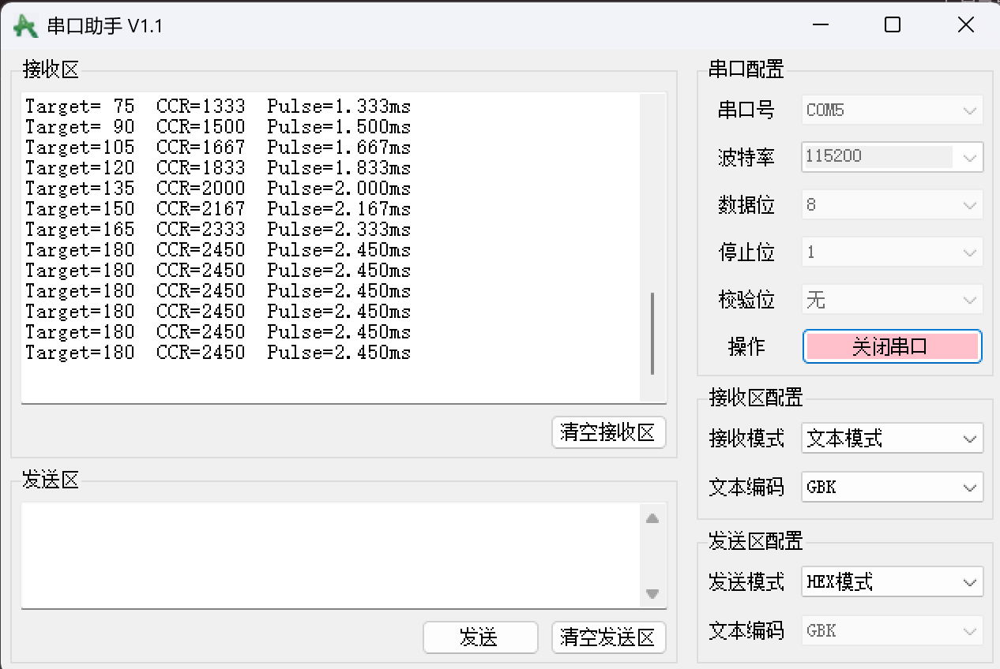

# RM-2027 电控培训 · 第四次作业：PWM 驱动 SG90 舵机

| 项目 | 内容 |
|---|---|
| 姓名 | 丁澳 |
| 学号 | 20263001694 |
| 主控 | STM32F103C8T6（最小系统板） |
| 工具链 | arm-none-eabi-gcc 10.3.1 + CMake + CLion + OpenOCD |
| 舵机 | SG90（180° 型），TIM2_CH1（PA0）输出 50Hz PWM |
| 显示 | 0.96" IIC OLED（SSD1306），软件 IIC，PB8 = SCL / PB9 = SDA |

---

## 一、任务与完成情况

| 层级 | 内容 | 状态 |
|---|---|---|
| **必做** | 定角序列 0° → 45° → 90° → 135° → 180°，每点停 1 秒；OLED 与串口同步显示 Target / CCR / Pulse | ✅ 完成 |
| **进阶 A** | 两个按键：PA1 每次 +15°、PA2 每次 −15°，限幅 0~180°，OLED 实时跟随 | ✅ 完成 |

---

## 二、PSC / ARR 的推导

### 1. 先确定定时器时钟

TIM2 挂在 **APB1** 总线上。本工程：

```
HCLK    = 72 MHz        （SystemClock_Config 里 PLL ×9）
APB1    = 36 MHz        （AHB 不分频，APB1 分频系数 = 2）
```

关键一步：**APB1 的分频系数不为 1 时，挂在 APB1 上的定时器时钟会被硬件自动 ×2**。

```
TIM2 计数时钟 f_tim = 36 MHz × 2 = 72 MHz
```

> 如果按 36MHz 去算 PSC，PWM 频率会正好差一倍（变成 100Hz 或 25Hz），
> 舵机完全不认这个信号。这是这一册最容易错的地方。

### 2. 目标频率与计数单位

SG90 只认 **50 Hz**：

```
周期 T = 1 / 50 Hz = 20 ms = 20000 µs
```

为了让角度换算简单，**取 1 个计数 = 1 µs**：

```
计数频率 f_cnt = 1 MHz
```

这样 CCR 的数值就直接等于脉宽（微秒），换算只需一次线性映射，
不用再乘除定时器系数，也不会因为整数运算丢精度。

### 3. 代入公式算 PSC / ARR

计数频率公式：

```
f_cnt = f_tim / (PSC + 1)
```

反解 PSC：

```
PSC = f_tim / f_cnt − 1 = 72 MHz / 1 MHz − 1 = 72 − 1 = 71
```

周期公式：

```
T = (ARR + 1) × (PSC + 1) / f_tim = (ARR + 1) × 1 µs
```

反解 ARR：

```
ARR = T / t_cnt − 1 = 20000 µs / 1 µs − 1 = 19999
```

### 4. 验算

```
PWM 频率 = f_tim / (PSC + 1) / (ARR + 1)
         = 72 000 000 / 72 / 20000
         = 50 Hz  ✅
```

| 参数 | 值 |
|---|---|
| Prescaler (PSC) | **71** |
| Counter Period (ARR) | **19999** |
| 1 个计数 | **1 µs** |
| PWM 频率 | **50 Hz**（周期 20 ms） |

---

## 三、角度 → CCR 的换算，以及两端为什么留余量

### 1. 名义映射

SG90 的名义对应关系是 **0.5 ms → 0°**、**2.5 ms → 180°**：

```
脉宽(µs) = 500 + 角度 / 180 × 2000
```

因为 1 计数 = 1 µs，所以 **CCR 数值 = 脉宽微秒数**：

| 角度 | 脉宽 | CCR |
|---|---|---|
| 0° | 500 µs | 500 |
| 45° | 1000 µs | 1000 |
| 90° | 1500 µs | 1500 |
| 135° | 2000 µs | 2000 |
| 180° | 2500 µs | 2500 |

### 2. 两端为什么要留余量

0.5 ms / 2.5 ms 是**名义值**。真实 SG90 的行程普遍比标称窄一点：
打到接近 500 µs 或 2500 µs 时，舵机会**顶到机械限位**，表现为：

```
· "咔咔"的响声
· 堵转电流急剧上升到 700 mA 左右
· 电机发热，长时间会烧毁
```

所以代码里把脉宽**限制在 550 ~ 2450 µs**（约 4.5° ~ 175.5°）：

```c
#define SERVO_MIN_US   550U     /* 0° 对应（留余量） */
#define SERVO_MAX_US   2450U    /* 180° 对应（留余量） */
```

**牺牲两端各约 4.5°，换来"永远不顶限位"**。文档也给了同样的结论：
"550~2450 这个区间对绝大多数 SG90 都安全"。

另外上电时先回 **90° 中位**，避免一上电就往极限位置甩。

---

## 四、接线（舵机独立供电，必须共地）

| 信号 | 接到 | 说明 |
|---|---|---|
| 舵机 橙线（信号） | **PA0**（TIM2_CH1） | 50Hz PWM |
| 舵机 红线（VCC） | **独立 5V 电源** | ⚠️ 不从板子 5V 取电 |
| 舵机 棕线（GND） | 独立电源 GND，**并与板子 GND 相连** | ⚠️ 不共地舵机不认信号 |
| OLED SCL | **PB8** | 软件 IIC |
| OLED SDA | **PB9** | 软件 IIC |
| OLED VCC / GND | 板子 3.3V / GND | |
| CH340 RXD / TXD | PA9 / PA10（交叉） | 115200，共地 |

**为什么舵机要独立供电**：SG90 堵转电流接近 700 mA，
从板子的 5V 取电会让板子电压跌落，轻则舵机抖动，重则单片机反复复位。

**为什么用 PA0 而不是 TIM4**：TIM4 的 CH1/CH2 是 PB6/PB7，
和 OLED 最常用的 IIC 引脚冲突，用 TIM4 出 PWM 会导致 OLED 莫名不亮。
PA0（TIM2_CH1）不与任何外设冲突。

**为什么 OLED 用 PB8/PB9**：把 PB0/PB1 的 ADC 通道让出来，
给队里常用的灰度、电位器模块留位置。

---

## 五、显示与输出格式

### OLED（三行）

```
Target:090deg      ← 目标角度，固定 3 位
CCR   :1500        ← 实际写进比较寄存器的值
Pulse :1.500ms     ← 换算出的脉宽（拆成整数/小数两段显示，避开浮点打印）
```

### 串口（USART1，115200，8-N-1）

```
Target= 90  CCR=1500  Pulse=1.500ms
```

两边内容完全一致，符合"OLED 与串口同步刷新"的要求。

---

## 六、程序结构

| 文件 | 职责 |
|---|---|
| `Core/Src/main.c` | 初始化、定角序列、按键处理、显示与打印调度 |
| `Core/Src/Servo.c` | `Servo_AngleToCCR()` 角度换算与限幅、`Servo_SetAngle()`、`Servo_Init()` |
| `Core/Inc/Servo.h` | 舵机接口与脉宽上下限宏 |
| `Core/Src/tim.c` | CubeMX 生成的 TIM2 初始化（PSC=71 / ARR=19999 / PWM1） |
| `Core/Src/OLED.c` | 群文件提供的软件 IIC SSD1306 驱动（引脚改为 PB8/PB9） |

### 关键设计：为什么主循环不是一串 `HAL_Delay`

必做的定角序列如果用 `for + HAL_Delay(1000)` 写，**这 1 秒内按键完全没反应**。
所以改成**时间戳驱动的非阻塞结构**：

```c
while (1)
{
    int8_t step = Keys_Poll();            /* 每 20ms 采样一次按键 */

    if (step != 0)                        /* 有按键：进入手动模式 */
    {
        s_manual = 1;
        Servo_SetAngle(Servo_GetAngle() + step * KEY_STEP_DEG);
        Show_State();
    }
    else if (!s_manual && (HAL_GetTick() - s_seq_ms) >= 1000U)
    {
        s_seq_ms = HAL_GetTick();          /* 定角序列：到点才切 */
        Servo_SetAngle(s_seq[s_seq_idx]);
        s_seq_idx = (s_seq_idx + 1) % 5;
        Show_State();
    }
}
```

效果：

- 序列按 1 秒节奏推进，**期间按键随时可以打断**（打断后进入手动模式，序列停止）；
- 任何角度看变化都**立即**写 CCR 并刷新 OLED / 串口；
- 整个过程没有一处阻塞等待。

### 按键消抖

PA1 / PA2 初始化为**输入 + 内部上拉**（按下为低电平）。
主循环每 **20 ms** 采样一次，检测"高 → 低"的跳变：

```c
if (now_low && !s_key_prev[i]) { ... }   /* 只在按下瞬间触发一次 */
s_key_prev[i] = now_low;
```

20ms 的采样周期天然覆盖了机械抖动（通常 < 10ms），
所以一次按下只会产生一次角度变化。

---

## 七、参考资料

| 来源 | 用途 |
|---|---|
| 电控 QQ 群文件《第三次培训所用资料》 | 软件 IIC OLED 驱动 `OLED.c` / `OLED.h` / `OLED_Font.h`（8×16 字模） |
| 《电控组第四次培训指导册》 | 时钟树、定时器、PWM、舵机的讲解与本作业要求 |
| Keysking 视频 | GPIO / 定时器 / PWM 基础 |
| 江协科技视频 | 定时器、PWM、舵机脉宽控制 |
| STM32CubeF1 固件包 V1.8.7 | HAL 库 |

---

## 八、串口输出截图



> 波特率 115200，文本模式（GBK），可见五个角度循环输出，
> 每次 `Target` 变化时 `CCR` 与 `Pulse` 同步更新。

---

## 九、演示视频

见 QQ 群「班级作业」提交的附件（30 秒内，舵机与 OLED 同画面）。
